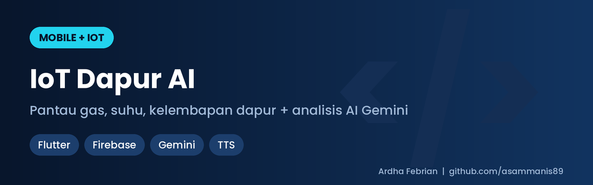
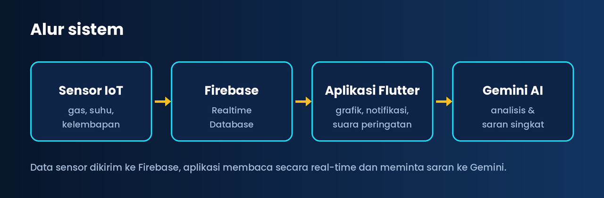

# IoT Dapur AI – Monitoring Dapur Pintar (Flutter + Firebase + Gemini)

Aplikasi mobile **Flutter** untuk memantau kondisi dapur secara real-time (gas, suhu, kelembapan) dari sensor IoT melalui **Firebase Realtime Database**, lengkap dengan **notifikasi**, **suara peringatan berbahasa Indonesia**, dan **analisis singkat dari AI Gemini**.


*Alur sistem*

## Fitur

- Data **real-time** dari sensor: gas (PPM), suhu (°C), kelembapan (%).
- **Grafik** tren sensor (fl_chart).
- **Notifikasi lokal** dan **suara (text-to-speech, bahasa Indonesia)** saat kondisi berbahaya.
- **Asisten AI (Gemini)**: menganalisis data sensor dan memberi saran satu kalimat apakah kondisi aman.

## Tech stack

Flutter · Dart · Firebase Core + Realtime Database · fl_chart · Google Generative AI (Gemini) · Provider · Flutter TTS · Flutter Local Notifications

## Struktur data Firebase

```
Dapur/
  Suhu
  Kelembapan
  Gas
```

## Cara menjalankan

1. Buat proyek Firebase dan Realtime Database, lalu tambahkan aplikasi Android. Unduh `google-services.json` ke `android/app/` (file ini tidak disimpan di repo).
2. Buat API key Gemini di Google AI Studio.
3. Jalankan:

```bash
flutter pub get
flutter run --dart-define=GEMINI_API_KEY=kunci_anda
```

## Keamanan

- **API key Gemini tidak boleh ditulis di kode.** Gunakan `--dart-define` seperti di atas.
- Atur **aturan Realtime Database** agar tidak terbuka untuk publik (`.read` / `.write` jangan `true` tanpa syarat).

## Pengembang

**Ardha Febrian Muqorrobin** – WhatsApp 081217529861 · [LinkedIn](https://www.linkedin.com/in/ardha-febrian-342317289/)
